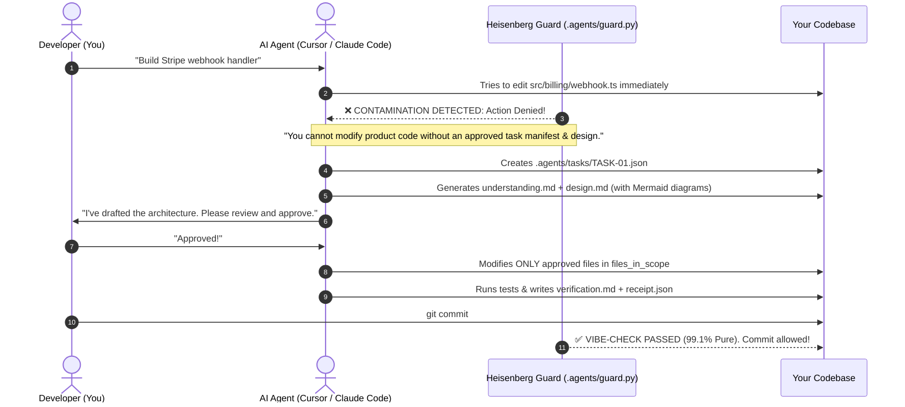

# ⚗️ Heisenberg // VibeCheck
> ### *"Your AI is vibe-coding. Heisenberg is the Vibe Check."*  
> **99.1% Pure Code. Zero Contamination. No Unauthorized Edits.**

[](https://npmjs.com/package/heisenberg-vibecheck)
[](LICENSE)
[](https://github.com/Mubashar986/heisenberg-vibecheck/pulls)

AI coding agents (Cursor, Claude Code, Copilot, Antigravity, Windsurf) are transformative—until they make unannounced drive-by edits, fabricate test results, hallucinate silent mocks, and break your production architecture.

**Heisenberg is the local, zero-dependency circuit breaker that puts your AI through a strict Vibe Check before any code is modified.**

---

```text
 ⚗️  H E I S E N B E R G  //  V I B E C H E C K
 ===============================================
  99.1% Pure Governance Engine for AI Agents
```

---

## ⚡ 1-Second Setup (Zero Config)

Run this in the root of **any** project (TypeScript, Python, Go, Rust, Java, React, Next.js):

```bash
npx heisenberg-vibecheck
```

### What happens instantly:
- 📁 **Zero Project Clutter**: Everything (rules, skills, schemas, and guard engine) lives cleanly inside a single hidden `.agents/` folder. Your source tree stays pristine.
- 📜 **The Master Constitution**: Installs `AGENTS.md` at root—the supreme contract that AI agents read and obey automatically.
- 🛡️ **Universal Bouncer**: Arms `.git/hooks/pre-commit` to physically reject unverified AI commits in `0.04s` (works across 100% of AI tools).
- 🔌 **Native IDE Hooks**: Automatically configures Cursor (`.cursor/hooks.json`), Claude Code, and Antigravity pre-tool interception.

---

## 🛑 The Core Law: The Vibe-Check Gate



---

## 🌟 The 6 Superpowers of Heisenberg

### 1. 📁 Zero Project Clutter
Unlike other governance frameworks that pollute your repository with 6 different root directories, Heisenberg packages everything cleanly:
```text
your-project/
├── AGENTS.md                  <-- ONLY 1 file in root (the contract AI reads)
├── .agents/                   <-- The Heisenberg Laboratory (Hidden)
│   ├── guard.py               <-- The local gatekeeper & validator
│   ├── policy.json            <-- Active gates configuration
│   ├── skills.json            <-- Skills registry
│   ├── rules/                 <-- The 4 Universal Laws (WBS, ADR, Errors, Git)
│   ├── skills/                <-- Complete skills library (Pluto, Muses, Grill)
│   ├── tasks/                 <-- Active task manifests (.gitkeep)
│   ├── artifacts/             <-- Generated design & understanding docs
│   └── receipts/              <-- Certified completion receipts
└── src/                       <-- Your actual application code (untouched!)
```

### 2. 🥩 The 10-Point Concept Grill Battery
Before code design begins, the AI must stress-test the concept against **10 failure vectors**:
1. **Analogy Breakdown**: Where does the abstraction leak?
2. **Zero-Magic Trace**: Step-by-step execution across sockets, heap, and event loops.
3. **Concurrency Races**: What happens if two requests hit at 0ms?
4. **Partial Failure**: If step 3/5 crashes, what gets corrupted?
5. **Space-Time Big-O**: Does RAM explode at 100× data scale?
6. **Security Seams**: Malicious payload and injection analysis.
7. **10-Year-Old Test**: Explain the core loop in 2 plain sentences.
8. **Deprecation Check**: Modern idioms vs obsolete legacy patterns.
9. **Reversal / Rollback**: Exact inverse compensating transactions.
10. **Human Alignment**: Explicit developer sign-off.

### 3. 📊 Living Visual Architecture (Mermaid Diagrams)
Never guess how a past feature was built. Heisenberg forces the AI to output **visual Mermaid sequence diagrams and flowcharts** inside `.agents/artifacts/TASK-XX/design.md`. Your project automatically generates its own visual architecture documentation as you code.

### 4. 🔄 Infinite Chat Continuity (Zero Context Loss via WBS)
Tired of "AI amnesia" when chat sessions get long? With Heisenberg, the single source of truth is on disk in `.agents/tasks/`. Open a new chat in Cursor or Claude Code anytime and say:
> *"Resume TASK-03."*

The AI reads the manifest, loads the approved design, and resumes immediately without losing context.

### 5. 🛠️ On-Demand Investigation Aids
Trigger instant, lightweight utilities whenever you need them:
- **`bro`**: Tells the AI: *"Drop the corporate fluff and jargon. Speak to me like one senior engineer to another over coffee."*
- **`how`**: Rapidly traces execution flow across modules: *"Where should this function live?"*
- **`why`**: Runs git archaeology, blames past commits, and uncovers historical design rationale.

### 6. 🛑 2-Strike Rollback Protocol
When an error occurs, unconstrained AI agents enter panic loops—making 5 hasty patches that break more files. Heisenberg enforces the **2-Strike Rollback**:
> If an AI fails twice consecutively to fix an error, it is required to run `git checkout .`, revert to baseline, and perform an Ishikawa 5-Whys Root Cause Analysis before attempting another fix.

---

## 💻 CLI Commands

```bash
# 1. Unpack Heisenberg into current directory
npx heisenberg-vibecheck

# 2. Run the Vibe-Check validator
npx heisenberg-vibecheck validate
# or alias:
npx vibecheck validate

# 3. View active task manifest status & artifact completion
npx heisenberg-vibecheck status
```

---

## 🔒 Security & Privacy

- **100% Local & Offline**: Heisenberg runs entirely on your local machine using standard Python and Node.js.
- **Zero Telemetry**: No code, prompts, or file paths are ever transmitted to any remote server.
- **Secrets Scan**: Pre-stage git scanner blocks accidental commits of `.env`, `*.pem`, `token.json`, or API keys.

---

## 📄 License

MIT © [Mubashar986](https://github.com/Mubashar986)
