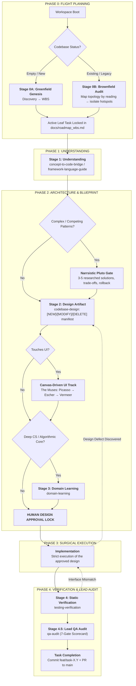
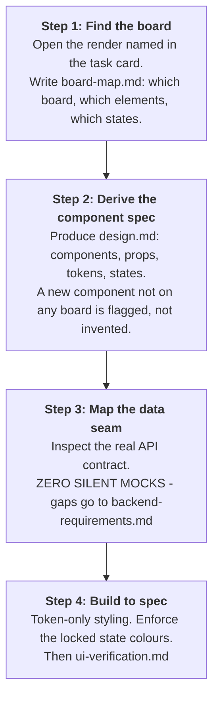

# Rule 02: The Stage-Gated Engineering Lifecycle

> **STATUS: OPERATIONAL LAW — ZERO UNPLANNED CODE**
> Spontaneous coding, un-gated file editing, or drifting from the active
> roadmap task is prohibited. Every code change is calculated, verified, and
> recorded — the depth of that process scales with the risk of the task.
>
> **Reading note:** this rule previously described a design studio and a graph
> engine. Both are gone. The UI path now points at the locked design canvas
> (`docs/ui-reference/`), and every graph tool is replaced per `AGENTS.md` §5.

---

## 1. The Lifecycle



---

## 2. Greenfield vs. Brownfield Onboarding

### Protocol A: Greenfield (Brand-New Repository)
1. **Discovery interview.** Lock the core problem and user, the MVP core loop,
   the technology selection (formalized as a decision record), and the hard
   constraints.
2. **WBS generation.** Scaffold the roadmap with ownership, acceptance
   criteria, and named gates.
3. **First task.** Create the task manifest, cut the branch, begin Stage 1.

> This project completed Stage 0 on 2026-10-11. The roadmap is
> `docs/roadmap_wbs.md` and the closed decisions are
> `docs/DECISIONS-LOCKED.md`. Do not re-run the genesis interview.

### Protocol B: Brownfield (Legacy Codebase)
1. **Do no harm.** Do not rewrite existing code, restructure directories, or
   propose mass refactors before you have mapped the system by reading it.
2. **Map the topology.** Read the manifests, the ORM schemas, the route
   definitions, and the entry points. Write down what exists.
3. **Find the hotspots.** Identify god-objects with many incoming callers, and
   note where tests exist and where they do not.
4. **Strangler seam.** Wrap legacy behaviour behind an interface and build new
   capability through that seam. Leave legacy callers untouched.
5. **Brownfield WBS.** Phase 1 audit, Phase 2 seam isolation, Phase 3
   incremental delivery.

---

## 3. The Canvas-Driven UI Track

**This project's UI is already designed.** The authoritative source is the
37-board design canvas at `docs/ui-reference/`:

- `DESIGN-CANVAS-37-boards.pdf` — the screens and visual language
- `DESIGN-CANVAS-agentic-loop-state-machine.pdf` — the loop spec
- `renders/spec_01.png … spec_37.png` — per-board renders

**The agent is forbidden from re-designing what the canvas already decides.**
Aesthetic, colour, layout, hierarchy, component shape, and copy strings are
locked. The agent's job is to *implement the board*, not to reinterpret it.

### The UI sequence (4 steps)



**Locked colour language** (from the canvas — do not deviate):

| State | Colour |
|---|---|
| Correct answer | emerald green |
| Incorrect answer | amber / orange — **never red** |
| Current stage | blue-violet |
| Locked / not yet reached | grey outline |

Cards are **single-layer** soft cards with large radius. The double-bezel
nested architecture described in earlier versions of this rule is **not used**
in this project.

---

## 4. The Non-Negotiable Laws of the Lifecycle

### LAW 1: The Active Leaf Task Mandate
No agent may design, edit, or test code without stating the exact active leaf
task ID from `docs/roadmap_wbs.md`. Root epics or vague tasks are not
actionable.

### LAW 2: The Anti-Scope-Creep Halt
If a prompt, discovered bug, or requirement expands beyond the active leaf task:
```
STOP → Document Scope Delta → Update the roadmap → Select New Leaf Task → Resume
```
Silent scope expansion is a contract violation.

### LAW 3: Stage 1 Cognitive-to-Code Mapping
Before designing changes, produce `understanding.md` mapping the real-world
mental model, the actual execution flow traced through the code, and verified
facts versus inferred assumptions.

### LAW 4: The Narrsistic Pluto Architectural Gate
Required when choosing between competing patterns, refactoring a core engine,
or investigating a difficult bug. Produce `architecture-analysis.md` with 3–5
viable solutions, honest rejection reasons, a blast-radius assessment, and
rollback triggers. Not a default for ordinary tasks.

### LAW 5: Deterministic Blast Radius Gate (Stage 2)
In `design.md` the agent is forbidden from guessing caller impact. Every
downstream caller must be identified by reading the code and listed explicitly,
with how each was checked. (This replaces the former `graph_impact` step.)

### LAW 6: Explicit File Mutation Manifest
The Stage 2 design must classify every affected file:
- `[NEW] path/to/file`
- `[MODIFY] path/to/file`
- `[DELETE] path/to/file`

### LAW 7: The Implementation Code Lock
The agent is blocked from using code-writing tools until the Stage 2 design
artifact has been presented to and accepted by the user. **This applies in full
to UI work.** For non-UI work, `AGENTS.md` §3 defines the gate: the manifest's
artifact list, scaled to risk.

### LAW 8: Zero Silent Redesign (Design Defect Re-entry)
If implementation reveals the approved design is flawed or incomplete:
```
HALT → Re-enter Stage 2 → Update the design artifact → Obtain sign-off → Resume
```
Do not improvise in code.

### LAW 9: The Data Seam Gate
Before writing UI that touches backend data, inspect the real OpenAPI or route
schema. If the UI needs a field the backend does not provide: **zero silent
mocks** — log it in `backend-requirements.md` and raise it with the user.

### LAW 10: Token Enforcement
All UI code must use design tokens. Zero raw hex codes, zero arbitrary pixel
values. Every interactive element implements its full state set.

### LAW 11: First-Principles CS Domain Extraction (Stage 3)
Triggered for search relevance tuning, auth/crypto math, incremental
watermarking, ranking, or encryption models. Analyse: first principles →
mathematics → generic mechanism → implementation → failure modes.

### LAW 12: Architectural Boundary Preservation
Core domain logic has zero external SDK dependencies. Database drivers, Google
APIs, and third-party SDKs live behind swappable interface adapters.

### LAW 13: Commit as the Change Record
In the same turn a file is modified, commit it with a conventional message
that names the task and summarises the change. The diff is the audit trail.

### LAW 14: Targeted Verification Gate (Stage 4)
Run the targeted test command covering the task's `files_in_scope` files and
record the raw output in `verification.md`. Confirm signatures and return types
by reading the code, confirm every caller still matches, confirm the contract is
honoured.

### LAW 15: Broad-Suite Exemption
Full project suites and interactive watchers (`--watch`, repo-wide `pytest` /
`npm test`) run only on explicit user instruction (`run test`); the PR pipeline
(CI) runs the full suite for every pull request.

### LAW 16: Terminal Command Error Lock
Any terminal failure halts all other work immediately. No blind retries. Log
the incident and run a 5-Whys RCA (see Rule 04).

### LAW 17: Living Decision Registry Synchronization
No library, database, or architectural pattern may be introduced without an
accepted decision record in `docs/DECISIONS-LOCKED.md` (see Rule 03). If it is
pending, halt and resolve it first.

### LAW 18: Task-Isolated Conventional Git Protocol
Every task runs on `feat/task-X.Y-<slug>`. Commits follow
`<type>(<scope>): [Task-X.Y] <imperative summary>`.

### LAW 19: Full-File Inspection Before Closing
Before declaring a task complete, inspect the entirety of every modified file
to guarantee zero residual placeholders, debug statements, or broken syntax.

### LAW 20: Completion Memory Persistence
Upon completing Stage 4, record the milestone in
`.workbuddy-ai/memory/YYYY-MM-DD.md` and update the roadmap if scope moved.

---

## 5. Stage Transition Verification Matrix

| Transition | Prerequisite | Blocking Failure |
|---|---|---|
| **Boot → Stage 0** | Repository state identified | Unknown mode |
| **Stage 0 → Stage 1** | Approved leaf task ID in the roadmap | Ambiguous or multi-feature scope |
| **Stage 1 → Stage 2** | `understanding.md` produced | Missing call flow or unstated assumptions |
| **Stage 2 → UI Track** | Canvas board identified and referenced | Implementing UI with no board and no escalation |
| **UI Track → Data Seam** | Real backend contract inspected | Mock data created without logging it |
| **Stage 2 → Impl** | `design.md` with caller list approved | Missing blast radius or un-demarcated files |
| **Impl → Stage 4** | Code written and committed | Uncommitted or unexplained edits |
| **Stage 4 → Complete** | `verification.md` confirmed | Broken callers or failing acceptance criteria |
