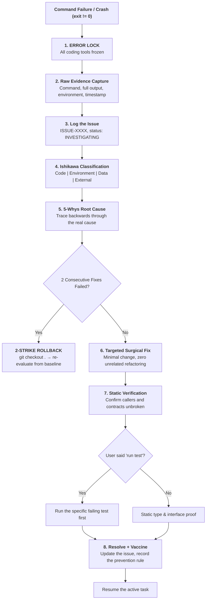

# Rule 04: Error Lock & Incident RCA Protocol

> **STATUS: OPERATIONAL LAW — ZERO PANIC PATCHING**
> Any terminal failure, runtime crash, broken test, or unhandled exception
> triggers a **hard stop**. The agent is forbidden from trying quick random
> patches or alternative commands blindly.

---

## 1. Why the Error Lock Exists

In unconstrained AI coding, an error triggers a panic loop:
1. The agent guesses a quick fix.
2. The fix modifies code it does not fully understand.
3. A new error appears in an adjacent file.
4. Another hasty patch.
5. Within five turns the codebase is broken and the original failure is buried.

The lock breaks that loop: freeze, capture evidence, find the cause, then apply
one surgical fix.



---

## 2. The Laws

### LAW 1: The Immediate Execution Freeze
The moment any command exits non-zero or an unhandled exception occurs, the
agent is blocked from further code changes. It cannot "try another command" or
"see if this works".

### LAW 2: "Disappearing Error ≠ Resolved Error"
An error that vanishes because code was commented out, silenced with
`@ts-ignore` / `except: pass`, or bypassed with a dummy mock is an **unverified
hack**, not a resolution. The cause must still be addressed.

### LAW 3: The 5-Whys Depth Mandate
Trace the failure back through at least five layers:
1. **Symptom** — why did the build or test fail?
2. **Immediate cause** — why was that value undefined or that function missing?
3. **Mechanism** — why was that state not passed or parsed correctly?
4. **Upstream seam** — why did the caller assume a different contract?
5. **Root cause** — what architectural assumption allowed this to exist?

### LAW 4: The Ishikawa Classification
Every incident is one of four kinds:
- **Code logic** — algorithm error, type mismatch, null pointer.
- **Environment & config** — missing `.env`, port collision, PATH resolution.
- **Data & schema** — missing column, unmigrated state, stale cache.
- **Dependency & external service** — rate limit, timeout, upstream break.

### LAW 5: The Issue Register
Every non-trivial failure is recorded in `docs/issues.md` with a sequential ID
and a lifecycle: `OPEN | INVESTIGATING | MITIGATED | RESOLVED`.

### LAW 6: Complete Raw Evidence
Record the exact command, the untruncated output, exit codes, stack traces, and
timestamps. Truncating or paraphrasing an error trace is prohibited.

### LAW 7: Caller Impact Audit
Before touching a file to fix an error, identify every downstream caller and
record how you checked it. Fixing a function without knowing its callers is how
one bug becomes three. (This replaces the former graph-impact step.)

### LAW 8: Targeted Fix Only
The fix contains only the minimal code needed to resolve the root cause.
Reformatting, renaming, or refactoring adjacent code during a bug fix is
prohibited. If the code needs cleanup, that is a separate task.

### LAW 9: Regression Verification
After the fix, re-read every direct caller to confirm interface contracts and
return types are still correct.

### LAW 10: User-Authorized Testing
If the user explicitly says `run test`: run the specific failing test first,
then the immediate regression suite. Zero unsolicited test runs otherwise.

### LAW 11: No Silent Swallowing
Production code never contains empty catch blocks (`catch (e) {}`), bare
`except:`, or unhandled promise rejections used to mask a failure. Errors are
logged and handled through typed error envelopes.

### LAW 12: The 2-Strike Rollback
If two consecutive fix attempts fail: **halt**. Run `git checkout .` to return
to the last known-good commit, then re-evaluate the root cause from scratch.
Do not dig deeper into a hole.

### LAW 13: Memory Compounding
When an issue is resolved, record the lesson in
`.workbuddy-ai/memory/YYYY-MM-DD.md` so the same mistake is not repeated in a
later session.

### LAW 14: Dependency Seam Check
If an error came from an external API, confirm the call sits behind an adapter
with backoff and graceful degradation.

### LAW 15: Flaky Error Isolation
Non-deterministic failures (race conditions, async timing) are flagged as
`FLAKY` in the issue register and analysed, never dismissed as "it works now".

### LAW 16: Evidence Grounding
Tag every diagnostic statement:
- `[VERIFIED]` — proven by output, logs, or a direct code read.
- `[INFERRED]` — logical deduction from verified facts.
- `[ASSUMED]` — unverified hypothesis; confirm before editing code.

### LAW 17: Security Escalation
Plaintext credentials in logs, hardcoded tokens, or injection risk escalate to
`SEVERITY: CRITICAL` and are resolved before feature work continues.

### LAW 18: Scope Delta Check
If the fix requires a schema change, a new library, or an interface rewrite,
halt and update the roadmap to reflect the scope change.

### LAW 19: The Vaccine Mandate
Every resolved issue states its prevention rule:
> *"What constraint, type check, or lint rule do we add so this class of bug
> cannot physically happen again?"*

### LAW 20: Clean Re-entry
Once the issue is closed and verified, resume the active task at Stage 4.

---

## 3. Issue Record Template (`docs/issues.md`)

```markdown
## ISSUE-[XXXX]: [Short Imperative Title]

- **Status:** [OPEN | INVESTIGATING | MITIGATED | RESOLVED]
- **Severity:** [CRITICAL | HIGH | MEDIUM | LOW]
- **Date:** YYYY-MM-DD HH:MM:SS
- **Active Task:** Task-X.Y
- **Component:** [Mobile | Backend | Database | Auth | Admin]

### 1. Raw Evidence
- **Command:** `[exact command]`
- **Exit code:** `[code]`
- **Output:**
```text
[complete untruncated output]
```

### 2. Ishikawa Classification
- **Category:** [Code Logic | Environment | Data | External]
- **Failure seam:** [where it broke]

### 3. 5-Whys
1. Symptom —
2. Immediate cause —
3. Mechanism —
4. Upstream seam —
5. Root cause —

### 4. Caller Impact
- **Files changed:** `[paths]`
- **Callers checked:** `[caller]` [VERIFIED COMPATIBLE]

### 5. Surgical Fix
- [minimal change made]

### 6. The Vaccine
- [prevention rule added]

### 7. Resolution
- **Verified via:** [static read / user-authorized test]
- **Date:** YYYY-MM-DD HH:MM:SS
```
