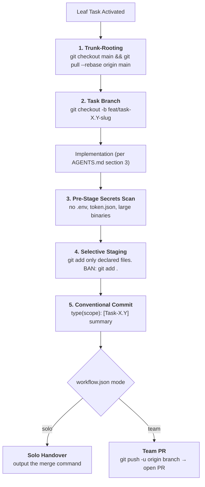

# Rule 05: Git Branching & Team Protocol

> **STATUS: OPERATIONAL LAW — ZERO REPO POLLUTION**
> Blind `git add .`, committing directly to `main`, unverified merge-conflict
> resolutions, and untracked dirty state are prohibited. Every commit is atomic,
> conventional, and task-isolated.

---

## 1. Why Git Hygiene Protects Velocity

AI agents write code fast. Constrained poorly, they create catastrophic messes:
- `git add .` commits a `.env` with live API keys.
- Long-lived branches diverge from teammates and produce nightmare conflicts.
- Commit messages say "update code" or "fix stuff".
- One task becomes twenty micro-commits, or five features become one blob.

This protocol exists so **the sole reviewer can trust every diff at a glance**.



---

## 2. The Laws

### LAW 1: Trunk-Rooting
Before starting a task, ensure the repo is clean and rebased onto the latest
target branch:
```bash
git checkout main && git pull --rebase origin main
```
Building on stale, un-synced code is prohibited.

### LAW 2: Task-Isolated Branches
Work directly on `main` is prohibited. Every task runs in its own branch:
- Features: `feat/task-X.Y-<kebab-slug>`
- Fixes: `fix/task-X.Y-<kebab-slug>`
- Hotfixes: `hotfix/issue-XXXX-<slug>`

### LAW 3: The Ban on Blind `git add .`
`git add .`, `git add -A`, and blindly staging whole directories are a **direct
failure**. Stage only the files the task manifest declares:
```bash
git add backend/app/services/auth.py backend/app/routes/auth.py
```

### LAW 4: Pre-Stage Secrets & Hygiene Scan
Before committing, check `git status` against this blacklist:
- `.env`, `.env.*` (except `.env.example`)
- `token.json`, `credentials.json`, `*.pem`, `*.key`
- `*.log`, debug logs
- `node_modules/`, `venv/`, `__pycache__/`, `.expo/`
- Any file over 10 MB

If a blacklisted file is untracked, add it to `.gitignore` before staging.

### LAW 5: The Conventional Commit Standard
```text
<type>(<scope>): [Task-X.Y] <imperative short summary>
```
Types: `feat`, `fix`, `docs`, `refactor`, `perf`, `chore`, `test`.

### LAW 6: Multi-Line Body for Non-Trivial Commits
Any commit touching more than two files or an architectural seam includes a
structured body:
```text
feat(auth): [Task-K4] Implement Google sign-in with PKCE

- Added the OIDC callback route and state record
- Persisted code_verifier across the redirect
- Updated the contract fixture for the new token shape
- Verified statically: 0 caller breakages
```

### LAW 7: Solo Mode
When `config/workflow.json` has `"mode": "solo"`, the agent commits to the
local task branch and outputs the merge command for the developer:
`git checkout main && git merge feat/task-X.Y --ff-only`.

### LAW 8: Team Mode
When mode is `"team"`, direct merges to `main` are prohibited. Push the branch
and open a Pull Request using the chassis in §3.

### LAW 9: No Auto-Merge, No Force-Push
The agent never auto-merges a PR and never runs `git push --force` against
`main`, `master`, or `develop`. **Merge approval is 100% human.**

### LAW 10: Worktree Isolation for Parallel Work
When multiple agents or people work in parallel, each works in an isolated
worktree so no two share an uncommitted working tree:
```bash
git worktree add ../feynman-mobile -b feat/task-MOB4-mock-toggle main
```

### LAW 11: One Commit Per Leaf Task
Exactly one logical commit per roadmap leaf task. Do not bundle three tasks
into one commit; do not fragment one task into ten.

### LAW 12: Clean-Tree Gate
With dirty uncommitted changes present, the agent cannot switch branches or
start a new task. Commit or stash first:
```bash
git stash push -m "Stash before Task-X.Y"
```

### LAW 13: Conflict Resolution by Reading
Blind `git checkout --ours` / `--theirs` is prohibited. Read both sides, find
the callers of each, and preserve the intended contract before resolving.

### LAW 14: Rebase Over Merge
Feature branches rebase onto `main` rather than creating merge-spaghetti
commits.

### LAW 15: The Handover Card
After committing, output a clean copy-pasteable block:
```text
┌── Git Handover ──────────────────────────────────────────┐
│ git push -u origin feat/task-K4-google-signin            │
└──────────────────────────────────────────────────────────┘
```

### LAW 16: The PR Chassis
All PRs follow the template in §3.

### LAW 17: Hotfix Fast-Track
Critical bugs bypass the feature queue and branch from the production tag:
`hotfix/issue-XXXX-<slug>`.

### LAW 18: The 10 MB Guardrail
Files over 10 MB are not committed to the index; use Git LFS or external
storage. (`docs/ui-reference/DESIGN-CANVAS-37-boards.pdf` is an already-tracked
exception at ~11.6 MB. Do not add more.)

### LAW 19: Commit-Completion Memory
When a task's commit lands, update the roadmap status and, for a durable
lesson, `docs/memory/`.

### LAW 20: Review Is the Bottleneck
One person reviews everything. Therefore: keep diffs under ten minutes of
reading, put the verdict-relevant facts first, and never open a PR you cannot
explain in three sentences. If you cannot identify the governing board or
contract, say so in the PR body rather than guessing.

---

## 3. Canonical Pull Request Template

```markdown
## [Task-X.Y]: [Short Imperative Title]

### 1. What changed
- [summary]
- [motivation]

### 2. File Manifest
- `[NEW]` `path/to/new_file`
- `[MODIFY]` `path/to/modified_file`
- `[DELETE]` `path/to/deleted_file`

### 3. Acceptance (from docs/roadmap_wbs.md)
- [ ] [criterion 1]
- [ ] [criterion 2]

### 4. Board / Contract
- **Board:** spec_NN.png (or: no UI)
- **Contract:** which endpoint(s), and which fixtures

### 5. Verification Evidence
- [x] Callers identified and listed in design.md
- [x] Contract matches the fixture
- [x] Zero silent mocks (or gaps logged in backend-requirements.md)
- [x] Pre-stage secrets scan: clean

### 6. Known gaps / not verified
- [anything you could not check]
```
