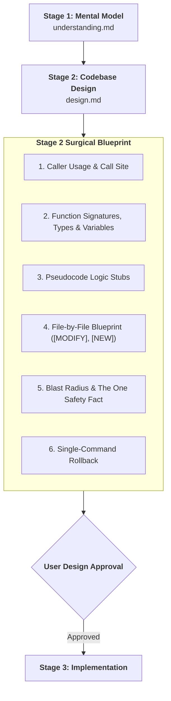

# Codebase Design: Blueprint Architect & Impact Analyst

> **STAGE GATE:** Stage 2 of the Heisenberg Engineering Lifecycle.  
> **PRIME DIRECTIVE:** Zero lines of implementation code (Stage 3) may be written until a surgical design blueprint is produced in `.heisenberg/artifacts/<TASK-ID>/design.md` and approved by the user. The agent acts as a Precision Architect: settling caller usage, sketching exact function signatures, variables, and pseudocode stubs—without triggering unprompted codebase-wide refactorings.

---

## 1. Role & Operating Principles

Stage 2 translates the verified mental model from Stage 1 (`understanding.md`) into a surgical file-by-file blueprint.

### The Core Anti-Slop Directives:
1. **The Laziness Protocol (Smallest Change):** Bias toward deletion and the smallest change that solves the problem. A leaf task must **never** invent abstract interfaces, mock adapters, or multi-file architecture overhauls unless the user explicitly orders an architectural refactoring.
2. **Signatures & Pseudocode First:** Settle types, function signatures, class shapes, and variables with pseudocode or `not implemented` bodies. The caller's usage must be proven before any implementation begins.
3. **The Zero-Code Hard-Lock:** Emitting final implementation code, complete JSX components, or modifying source files during Stage 2 is strictly forbidden. Stage 2 designs the change only.
4. **Deterministic Blast Radius:** Inspect real call sites to find what a change could break beyond what grep shows. Find the one critical fact that makes the change safe.
5. **Plan for Rollback:** Every design must provide a single copy-pasteable command to restore working state if implementation fails.



---

## 2. Pstack Principles Grounding the Design

Every design blueprint must apply these foundational principles from `pstack`:

* **`laziness-protocol`:** Refuse unnecessary abstractions, wrappers, or layers. Ask: *"What is the absolute minimum diff required to satisfy this requirement?"*
* **`type-system-discipline`:** Make illegal states unrepresentable. Refuse `any` or loose dictionaries where a typed schema belongs. Derive models from authoritative contracts (e.g. `/contracts`).
* **`boundary-discipline`:** Concentrate validation at system edges (API routes, CLI parameters, network payloads). Trust internal domain types and keep business functions pure.
* **`model-the-domain`:** Encode domain rules into state machines or typed models rather than scattered, nested `if/else` conditionals across files.
* **`subtract-before-you-add`:** Remove dead code, redundant validators, and obsolete stubs before bolting on new logic.

---

## 3. Caller Discovery & Blast-Radius Protocol

Before writing the design artifact, read the real code to discover callers and dependencies:

1. **Find Real Callers:** Read the route or function entry point. Trace who calls it, what arguments it passes, and what it expects in return.
2. **Find the Breakage Grep Won't Show:** Check JSON wire formats, database columns, config files, downstream event listeners, and unmount lifecycles.
3. **The One Safety Fact:** Identify the single fundamental fact the change is safe because of (e.g., *"This parameter is optional with a default value, so existing callers are completely unaffected"*).
4. **Never Hallucinate:** Verify every imported module, parameter name, and return type by reading the actual file.

---

## 4. The Canonical Design Artifact Structure (`design.md`)

The design blueprint written to `.heisenberg/artifacts/<TASK-ID>/design.md` must follow this concise, surgical structure. Do NOT write full file implementations—use pseudocode, signatures, and variable definitions:

### Section 1: Caller Usage & Call Site
Show how callers invoke the code today versus how they will call it after:
```python
# Before (Call Site):
result = grade_attempt(attempt_id="att_123")

# After (Call Site):
result = grade_attempt(attempt_id="att_123", mode=GradingMode.STRICT)
```

### Section 2: Exact Signatures, Types & Variables
Declare the target function/class signature, parameter types, return types, and primary variables:
```python
# target: backend/grading/evaluator.py::grade_attempt
class GradingMode(str, Enum):
    STRICT = "strict"
    LENIENT = "lenient"

def grade_attempt(
    attempt_id: str,
    mode: GradingMode = GradingMode.STRICT
) -> GradeResult:
    # Target variables:
    # - attempt: AttemptRecord (loaded from DB)
    # - score_threshold: float (0.85 for LAT mastery)
    ...
```

### Section 3: Pseudocode & Logic Flow
Show the algorithmic steps in pseudocode. Keep it high-level, clear, and focused on business rules:
```text
FUNCTION grade_attempt(attempt_id, mode):
    attempt = db.find_attempt(attempt_id)
    IF NOT attempt: RAISE NotFoundError
    
    raw_score = sum(1 for q in attempt.questions IF q.selected == q.correct)
    percentage = raw_score / len(attempt.questions)
    
    is_mastered = (percentage >= 0.85) IF mode == STRICT ELSE (percentage >= 0.70)
    
    RETURN GradeResult(score=raw_score, percentage=percentage, is_mastered=is_mastered)
```

### Section 4: File-by-File Blueprint
List only the files in scope, labeled explicitly:
* **`[MODIFY] path/to/file.ext`**
  - **Symbol Anchor:** `path/to/file.ext::symbol_name`
  - **Line Range:** `Lines 45–60`
  - **Nature of Change:** Add `mode` parameter with default value.
* **`[NEW] path/to/file.ext`**
  - **Single Responsibility:** Define enum/types if required.
* **`[DELETE] path/to/file.ext`**
  - **Proof of Zero Callers:** Reading confirmed zero remaining references.

### Section 5: Blast Radius & Safety Proof
* **Direct Callers Impacted:** List exact files and lines checked.
* **The One Safety Fact:** The exact proof why existing callers won't break.
* **Contract/SemVer Impact:** `PATCH` (internal), `MINOR` (additive), or `MAJOR` (breaking).

### Section 6: Rollback Plan
Copy-pasteable shell command to restore the workspace if implementation fails:
```powershell
# Uncommitted working tree:
git restore .
git clean -fd

# Committed feature branch:
git revert --no-edit HEAD
```

---

## 5. Database Schema Evolution: Expand-Contract Pattern

When a design requires database changes, apply the **Expand-Contract Pattern** to avoid breaking running instances:
1. **Expand (Phase 1):** Add new columns/tables as `NULLABLE` or with safe defaults. Never rename or drop active columns.
2. **Transition (Phase 2):** Code writes to both or reads from new with fallback.
3. **Contract (Phase 3):** Remove legacy columns in a dedicated follow-up task after verification.

---

## 6. Canonical Reference Artifact: `design.md`

Below is an example of an ideal, lean Stage 2 design artifact:

```markdown
# Stage 2 Design: Task 3.4 — Socratic Loop Remediation Counter

## 1. Caller Usage
```python
# In backend/loop/state_machine.py:
# Before:
next_stage = transition_stage(session, current_stage)
# After:
next_stage = transition_stage(session, current_stage, max_remediations=3)
```

## 2. Signatures, Types & Variables
```python
# backend/loop/remediation.py::check_remediation_limit
def check_remediation_limit(
    session_id: str,
    topic_id: str,
    max_loops: int = 3
) -> RemediationVerdict:
    # variables:
    # - loop_count: int (query count of prior remediation attempts)
    # - should_park: bool (loop_count >= max_loops)
    ...
```

## 3. Pseudocode Logic
```text
FUNCTION check_remediation_limit(session_id, topic_id, max_loops):
    attempts = db.query_attempts(session_id, topic_id, stage="remediation")
    IF len(attempts) >= max_loops:
        RETURN RemediationVerdict(action=Action.PARK_TOPIC, reason="Max remediation loops exceeded")
    RETURN RemediationVerdict(action=Action.CONTINUE_PRACTICE)
```

## 4. File-by-File Blueprint
- **[MODIFY]** `backend/loop/remediation.py`: Add `check_remediation_limit()` at lines 40–55.
- **[MODIFY]** `backend/loop/state_machine.py`: Call verdict check before re-entering practice stage.

## 5. Blast Radius & Safety Proof
- **Callers Checked:** `state_machine.py::step_turn` (line 112).
- **The One Safety Fact:** Default `max_loops=3` preserves existing loop behavior while enforcing DECISIONS-LOCKED B8.
- **SemVer:** MINOR (additive).

## 6. Rollback
```powershell
git restore backend/loop/
```
```

---

## 7. The 7 Design Red Flags

Reject any design blueprint that exhibits one of these red flags:
1. **Unprompted Architecture Overhaul:** Introducing abstract interfaces, factories, or multi-module refactorings for a simple leaf task.
2. **Missing Pseudocode / Signatures:** Proposing changes in vague prose without exact function signatures, variable stubs, and pseudocode logic.
3. **Uncontained Blast Radius:** Modifying $>5$ files or $>300$ net lines for a single leaf task (split the task instead).
4. **Leaky Transport Types:** Passing HTTP request/response objects (FastAPI `Request`, etc.) into core domain logic.
5. **Direct Column Renames:** Renaming database columns in a single migration script without using the Expand-Contract pattern.
6. **Silent Mocks:** Fabricating UI data without logging missing backend endpoints in `backend-requirements.md`.
7. **Missing Rollback Command:** Omitting a tested, single-command git restore command.

---

## 8. Interactive Design Approval Checkpoint

Upon writing `design.md`, present this structured summary to the user:

```text
╔══════════════════════════════════════════════════════════════════════════╗
║               STAGE 2: SURGICAL DESIGN BLUEPRINT COMPLETE                ║
╠══════════════════════════════════════════════════════════════════════════╣
║ Task:         TASK-X.Y — [Title]                                         ║
║ Artifact:     .heisenberg/artifacts/<TASK-ID>/design.md                  ║
║ Scope:        [N] files to modify | [N] new files                        ║
║ Signatures:   Exact types, variables, and pseudocode specified           ║
║ Blast Radius: [N] callers checked | Safe because: [The One Fact]         ║
║ Rollback:     Single-command restore verified                            ║
╠══════════════════════════════════════════════════════════════════════════╣
║ "Do you approve this surgical design blueprint to proceed to Stage 3?"   ║
╚══════════════════════════════════════════════════════════════════════════╝
```
