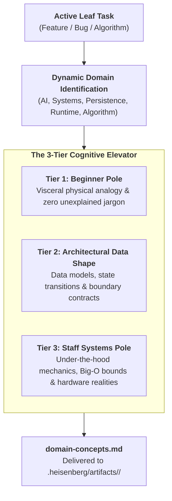

# Domain Learning: First-Principles Engineering Engine

> **STAGE GATE:** Stage 3 of the Heisenberg Engineering Lifecycle.  
> **PRIME DIRECTIVE:** Every line of code written in an application rests upon foundational engineering truths: memory layouts, runtime event loops, mathematical invariants, or neural context bounds. The agent must unpack the relevant domain touched by the task. It must make the mechanics instantly graspable for a **1st-semester beginner** through physical analogies while providing the rigorous, under-the-hood depth required by a **Principal / Staff Systems Engineer**.

---

## 1. Mission & The Dynamic Domain Horizon

Software engineering is frequently crippled by superficial recipe-copying without first-principles intuition. Developers memorize framework syntax but miss underlying computational realities until production fails under load.

### Rejection of Fixed Vectors:
Traditional systems trap models inside rigid checklists (e.g., fixed 15-vector taxonomies). Real-world applications—especially modern AI engines like The Feynman—cut across multiple evolving frontiers simultaneously. 

The agent **dynamically identifies the exact domain** of the task across the full software spectrum:

1. **AI, LLM & Cognitive Architecture:**
   - Prompt context budgets, KV cache memory footprints, token economics ($O(N^2)$ self-attention cost).
   - Sampling parameters (temperature, top-p, frequency penalties), deterministic tool-calling barriers.
   - Dense vector embeddings, cosine similarity, Approximate Nearest Neighbors (HNSW graphs).
   - Socratic dialog state machines, cognitive load pacing, hallucination and prompt-injection defense.
2. **Distributed Systems, Persistence & State:**
   - Relational ACID invariants, MVCC snapshot isolation, Write-Ahead Logging (WAL).
   - Sliding-window rate limiters, token buckets, idempotency keys, atomic transactions.
   - Streaming transport protocols: Server-Sent Events (SSE) with resumption vs WebSockets.
3. **Runtime & Virtual Machine Internals:**
   - Single-threaded event loops (Node.js/libuv, Python asyncio, React Native Hermes).
   - Garbage collection heuristics (mark-and-sweep, generational pauses), memory leaks.
   - Thread pools, async worker queues, JSI C++ bridges on mobile.
4. **Mobile & Client Engine Performance:**
   - Client thread models (UI Thread, JS Thread, Shadow/Render Thread).
   - Frame budget math ($\le 16.6\text{ms}$ budget for 60fps), Virtualized List windowing.
   - Memory management on budget 2GB Android devices (cold start budgets $\le 1.5\text{s}$).
5. **Operating Systems & Hardware Realities:**
   - CPU caches (L1/L2/L3, 64-byte cache line alignment), RAM pages (4KB), TLB misses.
   - Non-blocking I/O multiplexing (`epoll`, `kqueue`, `io_uring`), file descriptors.
   - Network socket buffers, TCP 3-way handshakes, TLS 1.3 session resumption.
6. **Data Structures & Asymptotic Limits:**
   - Hash maps (hash distribution, collision resolution via chaining/open addressing).
   - Priority queues (binary heaps), trees (B-Trees, tries, ASTs), graphs.
   - Amortized Big-O time and space complexity ($O(1)$, $O(\log n)$, $O(n \log n)$).



---

## 2. Pstack Principles Grounding Domain Learning

The agent anchors every domain analysis in these foundational principles from `pstack`:

* **`foundational-thinking` (Data Structures Before Logic):**  
  Apply before writing logic. Analyze the core types, memory layout, and data structures. When the data representation matches domain truth, downstream code becomes obvious.
* **`model-the-domain` (Structure over Spaghetti):**  
  Express domain rules in state machines, typed schemas, reducers, or algebraic data types. Replace scattered nested conditionals with cohesive structures.
* **`redesign-from-first-principles` (The "Why" Before the "How"):**  
  Answer: *"Why did human computer scientists invent this concept in the first place? What catastrophic failure or bottleneck does it eliminate?"*
* **`explain-the-number` (Grounding in Physical Reality):**  
  Never cite abstract latency numbers or speeds without explaining what physically limits them (network packets, disk seek heads, RAM bus bandwidth).

---

## 3. The 3-Tier Cognitive Elevator

Every domain analysis must bridge two cognitive extremes through three clear tiers:

### Tier 1: The Beginner Pole (Intuition First)
* **Zero Unexplained Acronyms:** Every term (ACID, SSE, AST, WAL, HNSW, JWT, MVCC) is unpacked in plain language upon first appearance.
* **The Visceral Physical Analogy:** Translates invisible electronic states into tangible, real-world mechanical systems (water pipes, diner kitchens, conveyor belts, filing cabinets, pneumatic tubes).
* **The First-Principles Origin:** Explains the historical human problem that led to the invention.

### Tier 2: The Architectural Data Shape
* **Data Invariants:** Defines what shapes flow through the system and what states are mathematically impossible.
* **Component Boundaries:** Identifies which actor owns mutation and which consumers read.
* **State Machine Mechanics:** Traces state transitions and triggers.

### Tier 3: The Principal / Staff Systems Pole (Under-The-Hood Rigor)
* **Asymptotic Proofs:** Formal Big-O time and space bounds (worst-case, best-case, amortized).
* **Kernel & Runtime Mechanics:** Traces exact runtime behavior (`epoll_wait`, event loop ticks, database buffer pools, memory allocation).
* **Hardware & Silicon Limits:** Evaluates cache line bouncing, memory alignment, context-switch overhead ($\approx 1.5\mu\text{s}$), and network round-trip time ($RTT$).
* **Adversarial Failure Analysis:** Models behavior under thundering herds, buffer bloat, split-brain scenarios, and race conditions.

---

## 4. First-Principles "Why" Case Studies

To anchor real intuition, the agent draws upon the historical reasons why key engineering mechanisms exist:

### Why Write-Ahead Logging (WAL) Exists
* *The Problem:* Writing randomly to a 10GB B-Tree database file forces physical disk heads to seek across spinning platters (taking 4ms per write) or causes flash write amplification on SSDs. If power cuts mid-write, internal tree pointers point into corrupted space.
* *The First-Principles Solution:* Append all changes sequentially to an immutable log file (`O(1)` append). Sequential writes max out disk bandwidth. If the machine crashes, the database simply replays the log from the last checkpoint.

### Why Single-Threaded Event Loops Exist
* *The Problem:* Spawning 10,000 OS threads for 10,000 web requests consumes 10GB of RAM (each thread takes $\approx 1\text{MB}$ stack space) and forces the CPU to burn 80% of its cycles on thread context switching ($\approx 1.5\mu\text{s}$ per switch).
* *The First-Principles Solution:* A single thread never waits on I/O. It registers file descriptors with the OS kernel (`epoll_wait`) and moves to other work. When data arrives, the kernel wakes the event loop. Result: 100k concurrent connections on 100MB RAM.

### Why Guarded State Machines Exist for LLMs
* *The Problem:* Large language models are probabilistic token predictors. If left to decide learning stages or student grades, they suffer from sycophancy, skipping practice steps, or declaring students "mastered" after 2 easy questions.
* *The First-Principles Solution:* The AI proposes; deterministic code disposes. A hardcoded finite state machine owns state transitions. The model is physically incapable of flipping a stage without backend code validating the threshold.

### Why Sliding-Window Rate Limiters Exist
* *The Problem:* Fixed-window limiters (e.g. 100 requests per hour resetting at :00) suffer from the "boundary burst" vulnerability: a client sends 100 requests at 1:59 and another 100 at 2:00, dumping 200 requests in 2 seconds onto downstream servers.
* *The First-Principles Solution:* A sliding window log (or token bucket) evaluates requests over a continuously moving time horizon ($t - \text{window}$). Every request older than the window drops off, guaranteeing that traffic never exceeds the limit over any arbitrary 60-minute interval.

---

## 5. Physical Mechanical Analogy Protocol

Analogies must be **mechanically accurate**, not just poetic. A good analogy mirrors the computational mechanism 1:1.

### Rules for Generating High-Fidelity Analogies:
1. **Mechanical Mapping:** Every moving part in the physical world must correspond directly to a code symbol or state variable.
2. **Failure Correspondence:** If the physical system breaks (e.g. water pipe bursts), it must explain the software failure mode (e.g. buffer overflow / OOM crash).
3. **Zero Magical Elements:** Use everyday objects with physical constraints (clocks, buckets, conveyor belts, levers, tickets).

### Example Mappings:
* **Write-Ahead Logging (WAL):** A restaurant waiter scribbling an order onto a pocket notepad in 2 seconds (sequential append log) before bringing water, then transcribing it to the giant leather ledger book later during downtime (B-Tree database file). If the power cuts, the pocket notepad survives.
* **Single-Threaded Event Loop:** A solo sushi chef standing behind a single prep counter. The chef starts the automated rice cooker (non-blocking I/O) and immediately slices salmon for customer #2. When the cooker bell dings (I/O event), the chef returns to assemble the roll. One chef, zero idle time.
* **Sliding-Window Rate Limiting:** A movie theater turnstile with a rotating wheel tracking stamped ticket stubs in the last 60 seconds. Rather than resetting abruptly at the top of the minute, old tickets fall off the conveyor continuously.
* **Vector Embeddings & Cosine Distance:** Compass bearings on a 3D globe. Words with related semantics are placed at nearby geographic coordinates. Checking similarity is simply measuring the angle between two compass needles.
* **Hermes Bytecode on Android:** Pre-assembling IKEA furniture at the factory before shipping (Ahead-Of-Time compilation), so the customer places it in their room instantly, rather than shipping a flat box of planks and screws that the customer must assemble in their living room before sitting down (JIT compilation).

---

## 6. Hardware Latency Reference (Jeff Dean Scale)

To keep systems engineering honest, evaluate operations against physical CPU time, scaled to human perception (where **1 CPU cycle = 1 second**):

| Operation | Real Hardware Latency | Scaled Human Time (1 Cycle = 1s) | Physical Reality |
|---|---|---|---|
| **1 CPU Cycle (3 GHz)** | **0.3 ns** | **1 second** | Single clock pulse |
| **L1 CPU Cache Access** | **0.9 ns** | **3 seconds** | Grabbing a pen from your pocket |
| **Branch Mispredict** | **3.0 ns** | **10 seconds** | Stumbling while walking |
| **L2 CPU Cache Access** | **2.8 ns** | **9 seconds** | Grabbing a book from your desk |
| **L3 CPU Cache Access** | **12.9 ns** | **43 seconds** | Walking to a colleague's desk |
| **Main RAM Access** | **100 ns** | **5.5 minutes** | Walking down the hall to the cooler |
| **NVMe SSD Random Read** | **16,000 ns (16 µs)** | **15 hours** | An overnight road trip |
| **Rotational Disk Seek** | **4,000,000 ns (4 ms)** | **4.5 months** | A full semester at college |
| **Datacenter Network RTT** | **500,000 ns (0.5 ms)** | **19 days** | A long vacation across the country |
| **Cross-Atlantic WAN Packet** | **150,000,000 ns (150 ms)** | **16 years** | Raising a child from birth to high school |

> **Key Invariant:** In-memory computations ($100\text{ns}$) are literally **hundreds of thousands of times faster** than disk or network requests. A missing index or redundant database roundtrip burns millions of CPU cycles.

---

## 7. Deep Technical Mechanics: Modern System Archetypes

### Archetype A: Dense Vector Retrieval & HNSW Indexing
* *The Core Problem:* High-dimensional embeddings ($d=768$ or $1536$) require evaluating cosine similarity across 1,000,000 vectors. A brute-force linear scan takes $O(N \cdot d)$ time ($\approx 500\text{ms}$ on CPU).
* *The Under-The-Hood Mechanics:* Hierarchical Navigable Small World (HNSW) constructs multi-layered skip-graphs. Upper layers have sparse long-range connections ($O(\log N)$ coarse routing); bottom layers have dense short-range clusters. The search zooms across layers in $<3\text{ms}$ with $>95\%$ recall.

### Archetype B: Redis Sliding-Window Rate Limiting (Sorted Sets)
* *The Core Problem:* Protecting expensive LLM API endpoints and quota tiers per student ($N=30$ attempts/day) without boundary burst vulnerabilities.
* *The Under-The-Hood Mechanics:* Implemented in Redis using a Sorted Set (`ZSET`):
  1. Record request timestamp: `ZADD quota:student_id <unix_ts> <req_uuid>`.
  2. Prune expired entries: `ZREMRANGEBYSCORE quota:student_id 0 <unix_ts - 86400>`.
  3. Count active entries: `ZCARD quota:student_id`.
  4. Compare count against daily limit. All 3 steps execute inside a single atomic Redis pipeline or Lua script ($O(\log M + M)$ where $M$ is quota size).

---

## 8. The Canonical Artifact Structure (`domain-concepts.md`)

The agent outputs the domain analysis to:
`.heisenberg/artifacts/<TASK-ID>/domain-concepts.md`

### Required Structure:
1. **Domain Identification & The First-Principles "Why"**  
   Name the exact technical domain (e.g. AI Prompt Systems, Relational MVCC, Client Threading) and state the root problem it solves.
2. **Code & Data-Shape Anchors**  
   List the exact symbols (`file::symbol`), schemas, and data structures involved.
3. **The Physical Mechanical Analogy (Beginner)**  
   The visceral, real-world metaphor explaining the concept with zero unexplained jargon.
4. **Under-The-Hood Systems Mechanics (Principal)**  
   Exact algorithm, kernel/VM runtime calls, memory structures, and hardware interactions.
5. **Asymptotic Complexity & Edge Boundaries**  
   Big-O time and space analysis ($O(1)$, $O(\log n)$), hardware limits, and failure modes under stress.

---

## 9. Canonical Reference Artifact: `domain-concepts.md`

```markdown
# Stage 3 Domain Analysis: Task 3.1 — Socratic 10-Stage Guarded State Machine

## 1. Domain Identification & First-Principles "Why"
- **Primary Domain:** Discrete Finite State Machines (FSM) & Deterministic Cognitive Architecture.
- **First-Principles "Why":** Pure LLMs are non-deterministic and hallucinate sequence order. If the model decides pedagogical progression, students skip practice, grade their own answers leniently, and miss learning gaps. Code must enforce the state machine; the LLM merely proposes conversational dialogue.

## 2. Code & Data-Shape Anchors
- **Symbols:** `backend/loop/state_machine.py::TutoringFSM`, `backend/models/session.py::SessionState`
- **Data Shapes:**
  - `Stage` (Enum with 10 values: `WARM_UP` through `MASTERY_CHECK`)
  - `StateTransition(from_stage: Stage, to_stage: Stage, condition_evaluator: Callable)`

## 3. The Physical Mechanical Analogy (Beginner)
*The Railroad Switching Yard:*
Imagine a passenger train traveling down a track with 10 stations. The conductor (the AI) talks to passengers and announces the stops, but the conductor cannot steer the train. Physical steel track switches (the Python state machine) are locked into the rails. The switch only flips to the next station when a mechanical sensor weighs the train and confirms 5 brass tokens have dropped into the hopper (the 85% mastery rule over 5 Level-4 questions). No matter what the conductor says over the intercom, the train cannot jump from Station 2 to Station 10.

## 4. Under-The-Hood Systems Mechanics (Principal)
- **Transition Determinism:** State transitions execute as an atomic PostgreSQL transaction with serializable snapshot isolation.
- **In-Memory Cache:** Active session states reside in Redis with sliding TTL (`EXPIRE session:id 86400`).
- **Turn Cap Barrier:** Tool loops are capped at $N=4$ calls per turn; exceeding the counter triggers a hard break to prevent runaway recursion.
- **Memory Footprint:** Each session FSM payload occupies $<2.4\text{KB}$ in memory, enabling 100k concurrent active student sessions within $\approx 240\text{MB}$ of Redis RAM.

## 5. Asymptotic Bounds & Edge Boundaries
- **Transition Lookup Complexity:** $O(1)$ constant time dictionary key lookup on `(current_stage, event_trigger)`.
- **Mastery Verification:** $O(k)$ where $k$ is recent attempts (bounded to $k=10$ attempts). Constant time $O(1)$.
- **Failure Mode (Remediation Lockout):** If a student fails 3 consecutive remediation cycles, the state machine transitions to `PARKED_TOPIC` (DECISIONS-LOCKED B8), preventing infinite AI chat loops.
```

---

## 10. The 6 First-Principles Red Flags

Reject any domain analysis that exhibits one of these red flags:
1. **Academic Vacuum:** Presenting a generic CS textbook summary without citing specific code symbols (`file::symbol`) in the repository.
2. **Unexplained Jargon:** Dropping terms like "ACID", "HNSW", or "MVCC" without immediately unpacking them for beginners.
3. **Broken Analogy:** Using an analogy that breaks under technical scrutiny or relies on magical assumptions.
4. **Missing Systems Reality:** Omitting under-the-hood memory, runtime, or concurrency implications for the backend/mobile client.
5. **Ignoring Asymptotic Complexity:** Failing to specify Big-O time and space bounds for critical algorithms or queries.
6. **Hand-Waving Numbers:** Citing latency or throughput claims without grounding them in physical limits (network RTT, disk I/O).

---

## 11. Interactive Domain Intelligence Checkpoint

Upon completing `domain-concepts.md`, present this structured summary to the user:

```text
╔══════════════════════════════════════════════════════════════════════════╗
║               STAGE 3: DOMAIN INTELLIGENCE COMPLETE                     ║
╠══════════════════════════════════════════════════════════════════════════╣
║ Task:         TASK-X.Y — [Title]                                         ║
║ Artifact:     .heisenberg/artifacts/<TASK-ID>/domain-concepts.md         ║
║ Domain:       [Identified Domain: AI / Systems / Persistence / Algorithm]║
║ Beginner Pole:[Physical Mechanical Analogy Defined]                      ║
║ Staff Pole:   [Kernel / Memory / Big-O Invariants Verified]              ║
║ Anchors:      [Exact code symbols & data shapes linked]                  ║
╠══════════════════════════════════════════════════════════════════════════╣
║ "Domain concepts grounded. Proceed with Stage 2 blueprint / Stage 3?"    ║
╚══════════════════════════════════════════════════════════════════════════╝
```
