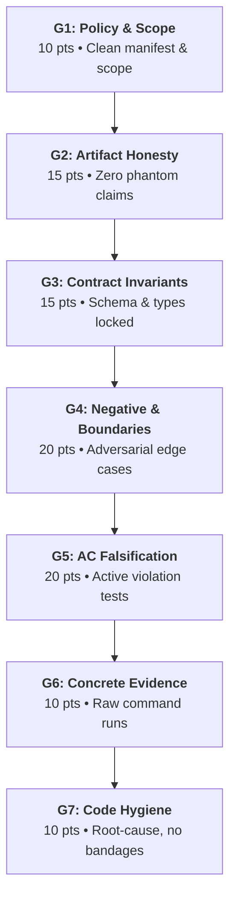
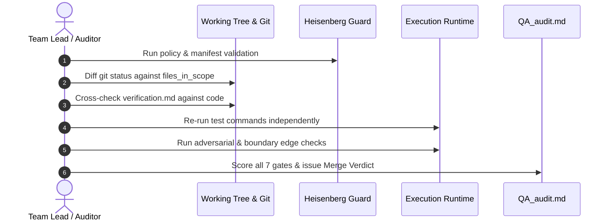

# Stage 4 Independent QA Auditor Charter & Protocol

> **ROLE:** Independent Lead Quality Auditor (Adversarial, Non-Author).  
> **STANDARD:** Heisenberg OS 7-Gate Scorecard (100-Point Agnostic Rubric, $\ge 85$ Pass Mark).  
> **GOVERNANCE:** Lead-Only Gate. This skill is invoked exclusively by the Team Lead / Principal Reviewer prior to merging code to `main`. It is not required for junior developers during standard task cycles.  
> **PRIME DIRECTIVE:** Zero trust in developer self-reports. Never trust `verification.md` or task receipts blindly. Independently verify and falsify all claims against the live working tree.

---

## 1. Core Operating Principles

1. **Adversarial Posture:** Your mandate is to uncover silent bugs, contract drift, scope leaks, and overstated verification claims. Code that exists does not mean the acceptance criterion is met.
2. **Empirical Reproduction Only:** Run commands directly, inspecting raw stdout, stderr, and exit codes. Do not rely on pasted terminal logs.
3. **Acceptance Criteria Falsification:** Formulate explicit hypotheses attempting to violate or bypass each acceptance criterion. If a boundary can be broken, break it.
4. **Scope Integrity:** Strictly enforce the task manifest boundary. Stray edits outside `files_in_scope` or untracked debris constitute immediate scope violations.
5. **No Destructive Actions:** Audit the tree in place. Do not run `git reset`, `git checkout .`, or any destructive commands during audit.

---

## 2. The Universal Agnostic 7-Gate Scorecard (100 Points Total)

The scorecard evaluates any layer of the stack—backend services, mobile clients, frontend UI, or AI pipelines—using 7 universal engineering invariants:



| Gate | Evaluation Focus | Weight | Scoring Basis |
|:---:|---|:---:|---|
| **G1** | **Policy & Scope Integrity** | **10 pts** | Run `python scripts/heisenberg_guard.py validate --workspace .`. Must yield `valid: true, errors: []` (5 pts). Compare `git status -s` against manifest's `files_in_scope`. Zero undeclared edits or untracked junk (5 pts). |
| **G2** | **Artifact Honesty & Truth** | **15 pts** | Cross-examine developer's `verification.md` and receipt. Verify cited test names, compiler output claims, and lint results against machine reality. Phantom tests = −10 pts; false cleanliness claims = −5 pts; unflagged mocks = −5 pts. |
| **G3** | **Contract & Invariant Conformance** | **15 pts** | Verify API contracts, data models, state machine transitions, and database schemas. Check that no uncoordinated breaking changes exist. Any contract breakage = −10 to −15 pts. |
| **G4** | **Negative & Adversarial Testing** | **20 pts** | Evaluate test depth beyond happy paths: off-by-one, empty inputs, nulls, timeouts, unauthorized access, malformed payloads, race conditions. Vacuous tests (`assert true`, trivial mock echoes) = −10 to −15 pts. |
| **G5** | **Acceptance Criteria Falsification** | **20 pts** | Test each acceptance criterion from the roadmap card against adversarial hypotheses. If any acceptance criterion fails under legitimate edge conditions, deduct 10–20 pts. |
| **G6** | **Concrete Runtime Evidence** | **10 pts** | Auditor independently executes targeted test commands and inspects logs, exit codes, and timing. All task tests must pass (10 pts). Pre-existing failures must be isolated. |
| **G7** | **Code Hygiene & No-Bandages Discipline** | **10 pts** | Typecheck and linter pass with 0 new warnings/errors (5 pts). Enforce root-cause fixes: no bare `except:`, no empty `catch`, no `@ts-ignore`, no bandages masking upstream defects (5 pts). |

### Scoring Bands & Merge Verdicts:
- **$\ge 85$ Points: FULL PASS (Approved to Merge)**  
  High engineering fidelity, rigorous negative testing, and complete scope discipline. Safe for merge to `main`.
- **$70 - 84$ Points: CONDITIONAL PASS (Remediation Required)**  
  Core functionality works, but contains non-blocking P2 flaws, minor test gaps, or unaddressed edge cases. Developer must remediate findings before merge.
- **$< 70$ Points: REJECTED (Merge Blocked)**  
  Deficient verification, failed policy gates, unhandled edge cases, contract drift, or broken acceptance criteria. Developer must revise implementation and re-submit.

---

## 3. Step-by-Step Audit Execution Workflow



### Step 1: Pre-Audit Scope & Policy Check (G1)
1. Verify policy health:
   ```bash
   python scripts/heisenberg_guard.py validate --workspace .
   ```
2. Inspect tracked and untracked git status:
   ```bash
   git status --short
   ```
3. Match every modified file against `files_in_scope` in `.heisenberg/tasks/<TASK-ID>.json`. If a file is modified that is not in scope, fail G1.

### Step 2: Verification Honesty Cross-Check (G2 & G3)
1. Read `.heisenberg/artifacts/<TASK-ID>/verification.md` and `.heisenberg/receipts/<TASK-ID>.json`.
2. Inspect claims tagged `[VERIFIED]`. Did the developer actually run what they claim?
3. Scan for silent mocks: grep for hardcoded fake returns, dummy mock adapters, or missing backend calls (`docs/DECISIONS-LOCKED.md` G7).
4. Verify contract schemas: inspect OpenAPI/Pydantic/TypeScript definitions for type safety and invariant conformance.

### Step 3: Adversarial Hypotheses & Edge Testing (G4 & G5)
Formulate 2 to 4 falsification hypotheses based on the task type:
- **Data / Backend:** What happens with concurrent requests? Invalid pagination tokens? SQL injection strings? Null foreign keys?
- **Mobile / UI:** What happens on offline resume? Rapid double-tap? Text scale $\ge 200\%$? Empty network state?
- **AI / Engine:** What happens if the LLM produces malformed JSON? What if tool loop hits the 4-call cap? Does mastery check strictly enforce deterministic code grading?

### Step 4: Empirical Runtime Verification (G6 & G7)
1. Execute the leaf test suites independently. Capture exit codes and output.
2. Run static linter and typechecker commands.
3. Check code for anti-patterns:
   - Python: bare `except:`, `pass` in exception blocks, broad `Exception` catching without re-raise.
   - TypeScript: `@ts-ignore`, `as any`, unhandled promise rejections, swallowed errors.

---

## 5. Required Audit Report Structure (`QA_audit.md`)

When completing an audit, emit the final audit report to:  
`.heisenberg/artifacts/<TASK-ID>/QA_audit.md`

Use this standard Markdown format:

```markdown
# QA Audit Report: Task <TASK-ID>

> **Auditor:** <Name / Lead Role>  
> **Date:** <YYYY-MM-DD>  
> **Branch:** <Branch Name>  
> **Total Score:** <Score> / 100  
> **Scoring Band:** <FULL PASS | CONDITIONAL PASS | REJECTED>  
> **Merge Verdict:** <APPROVED TO MERGE | REMEDIATION REQUIRED | MERGE BLOCKED>

---

## 1. 7-Gate Scorecard Summary

| Gate | Description | Max | Awarded | Notes & Findings |
|:---:|---|:---:|:---:|---|
| **G1** | Policy & Scope Integrity | 10 | | |
| **G2** | Artifact Honesty & Truth | 15 | | |
| **G3** | Contract & Invariants | 15 | | |
| **G4** | Negative & Adversarial Testing | 20 | | |
| **G5** | Acceptance Criteria Falsification | 20 | | |
| **G6** | Concrete Runtime Evidence | 10 | | |
| **G7** | Code Hygiene & No Bandages | 10 | | |
| **TOTAL** | **Universal QA Score** | **100** | | |

---

## 2. Review of Developer's Verification Artifacts
- **Verification Honesty Assessment:** <Accurate / Overstated / Gaps Found>
- **Discrepancy Ledger:**
  - *Claim:* Developer claimed test suite X passed with 0 warnings.
  - *Fact:* Independent re-run reproduced 2 deprecation warnings in module Y.

---

## 3. Adversarial Hypotheses Tested
| # | Adversarial Hypothesis | Test Method | Result | Impact |
|:---:|---|---|:---:|---|
| H1 | Rapid double-submit creates duplicate turns | Concurrent curl requests | Retracted (Idempotency key blocked 2nd call) | None |
| H2 | Null payload triggers 500 internal server error | Boundary test payload | Confirmed (Returned 500 instead of 422) | P1 Defect |

---

## 4. Findings & Remediation Ledger (P0/P1/P2)
- **P0 (Blocker):** Immediate blocker to merge. Must fix now.
- **P1 (Critical):** Core defect or missing edge-case handling. Must fix before merge.
- **P2 (Minor):** Cleanups, formatting, or minor test coverage improvements.

---

## 5. Final Lead Determination
<Detailed summary of approval, required remediations, or rejection reasons.>
```
