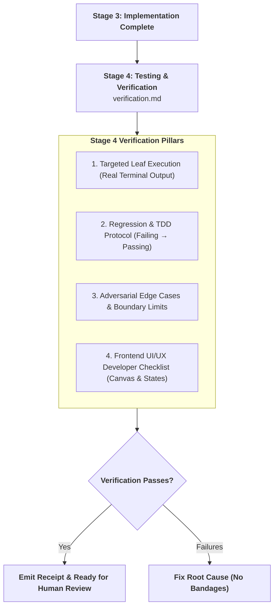

# Testing & Verification: Quality Auditor & Completion Gatekeeper

> **STAGE GATE:** Stage 4 of the Heisenberg Engineering Lifecycle.  
> **PRIME DIRECTIVE:** Zero tasks may be marked complete in `roadmap_wbs.md` without passing Stage 4 verification and generating the canonical `.heisenberg/artifacts/<TASK-ID>/verification.md` artifact. The agent acts as an uncompromising QA Auditor: executing targeted leaf tests, proving regression fixes via TDD, testing adversarial failure cases, and auditing UI/UX contracts against the locked canvas.

---

## 1. Role & The Targeted Leaf Testing Rule

Stage 4 provides the final, unyielding quality gate before code can be merged into `main`.

### The Targeted Leaf Testing Rule:
1. **Targeted Execution Mandate:** Inside an active task, the agent **must execute the specific, targeted test command** covering the files declared in `files_in_scope` (e.g., `pytest tests/test_grading.py -k test_lat_mastery` or `npm test -- components/QuizWidget.test.tsx`).
2. **Prohibited Broad Suites:** The agent is **strictly forbidden** from running full project-wide test suites (`pytest` across the entire repo, `npm test` across all packages) or launching interactive watchers (`--watch`) that waste tokens and lock the terminal.
3. **Prove It Works (No Self-Reports):** The agent must **never** claim a test passed unless verified terminal output was inspected directly. Tag every claim as `[VERIFIED]`, `[INFERRED]`, or `[ASSUMED]`.
4. **Zero Silent Failures:** No empty `except:` or `catch` blocks; no `@ts-ignore` used to hide real contract or typing bugs.



---

## 2. Pstack Principles Grounding Verification

Every verification cycle must enforce these core principles from `pstack`:

* **`prove-it-works`:** Verify against the real running artifact and actual outputs. Never rely on proxies, file timestamps, or "it compiles."
* **`test-behavior-not-implementation`:** Call the code the way callers and users do. Assert the result against literal expected values. If a test passes when every internal dependency returns `None`/`undefined`, the test is defective.
* **`fix-root-causes`:** When a test fails, trace the symptom to its root cause. Resist slapping `if x is not None:` nil-check bandages that silence crashes while leaving bugs alive.
* **`sequence-verifiable-units`:** Every task must end in an independently verifiable, working state that can be demonstrated to a reviewer in ten minutes.

---

## 3. The 4 Verification Pillars

Verification is never just happy-path unit tests. The agent must verify across four distinct dimensions:

### Pillar 1: Regression & TDD Protocol (For Bugs & Logic Changes)
When fixing a bug or altering business logic, prove the defect is resolved:
1. **Failing Before:** Run the targeted test to prove it fails for the intended reason. Capture the exact failure output.
2. **Minimal Fix:** Apply the minimal production change inside `files_in_scope`.
3. **Passing After:** Re-run the test to prove it passes cleanly with zero regressions.

### Pillar 2: Integration & Contract Testing
Verify that boundaries and persistence hold:
* **API Route & Schema Validation:** Endpoint returns expected status code, Pydantic/Zod DTO validates correctly, and reject malformed payloads with 422.
* **Database Transactions:** Verify atomic rollback: if a turn crashes mid-stream, zero partial state is committed to Postgres.
* **Redis Quotas:** Verify daily limits (e.g. LAT daily practice limit) decrement properly and reject requests once exhausted.

### Pillar 3: Adversarial Edge Cases & Failure Modes
Actively probe boundary conditions and destructive inputs:
* **Threshold Boundaries:** Test exact cutoff numbers (e.g., $84\%$ score fails mastery check; $85\%$ passes).
* **Null & Empty Inputs:** Test empty question lists, empty strings, and missing optional parameters.
* **Network & Streaming Drops:** Verify SSE reconnect behavior when connection drops mid-turn (`last_event_id` resume).
* **Encoding & Unicode:** Verify inputs with Urdu characters, emoji, and special symbols do not corrupt data or crash the parser.

### Pillar 4: Frontend UI/UX Developer Verification Checklist (UI Tasks)
When a task touches React Native or web admin screens, the agent must generate a concrete physical walkthrough for the developer:
1. **The 6 Visual States Matrix:**
   - Verify: `default`, `pressed/active`, `selected`, `focus`, `disabled`, and `loading/skeleton`.
2. **Canvas Design Compliance (`docs/ui-reference/`):**
   - Blue-violet primary accent for actions (`DECISIONS-LOCKED.md` **F2**).
   - Emerald green for correct; amber/orange for incorrect (**never red**, per **F5**).
   - Single-layer soft cards with large radius (no double-bezels, per **F7**).
   - Zero silent mocks: any missing backend field is logged in `backend-requirements.md` (**G7**).
3. **Device Ergonomics & Performance:**
   - Touch targets $\ge 48$dp / $44$px for all interactive buttons (**F13**).
   - Virtualized lists (`FlashList`) scroll at 60fps on budget Android devices (**E6**).
   - Zero Cumulative Layout Shift ($\text{CLS}=0$) with content-shaped pulsing skeletons.
4. **Step-by-Step Manual Walkthrough:**
   - Exact numbered steps for the developer to open the screen, tap controls, and verify visual and haptic feedback.

---

## 4. The Canonical Verification Artifact (`verification.md`)

The verification artifact written to `.heisenberg/artifacts/<TASK-ID>/verification.md` must follow this structure:

```markdown
# Stage 4 Verification: Task X.Y — [Task Title]

## 1. Targeted Test Execution
- **Command Run:** `pytest tests/test_grading.py -k test_lat_mastery`
- **Output:**
  ```text
  tests/test_grading.py::test_lat_mastery_threshold PASSED [100%]
  1 passed, 0 failed in 0.42s
  ```
- **Verdict:** [VERIFIED] All scoped tests pass.

## 2. Regression & TDD Evidence (If applicable)
- **Failing Before:** `AssertionError: Expected False on 84% score, got True`
- **Passing After:** `AssertionError resolved; correctly evaluates 84% as remediation needed.`

## 3. Adversarial Edge Cases Tested
| Case ID | Input / Condition | Expected Behavior | Observed Result | Status |
|---|---|---|---|---|
| **E-01** | Score = 84.9% (Below 85% gate) | Stage remains Practice (Remediation) | Correctly returned remediation stage | [VERIFIED] |
| **E-02** | Score = 85.0% (5+ Level-4 attempts) | Stage advances to Mastery | State machine emitted MASTERY_CHECK | [VERIFIED] |
| **E-03** | Malformed attempt payload (null attempt_id) | HTTP 422 Unprocessable Entity | HTTP 422 with validation error | [VERIFIED] |

## 4. Frontend UI/UX Developer Checklist (If UI task)
- [x] **6 States Checked:** Default, Pressed, Selected, Focus, Disabled, Loading.
- [x] **Palette Match:** Emerald green for correct, amber/orange for incorrect (no red).
- [x] **Touch Targets:** All pill buttons $\ge 48$dp.
- [ ] **Developer Manual Steps:**
  1. Launch app on emulator: `npx expo start --android`
  2. Tap LAT track $\to$ enter topic session $\to$ answer quiz question.
  3. Confirm amber highlight on wrong selection and THINKING accordion expands smoothly.

## 5. Code Quality & Invariant Audit
- [x] Zero silent mocks: No fabricated data in UI.
- [x] Zero swallowed errors: No bare `except:` or empty `catch`.
- [x] Strict typing: Zero `any`, all DTOs and models explicitly typed.
- [x] Diff size: Net lines $\le 300$, only files in manifest scope modified.

## 6. Atomic Commit Recommendation
- **Commit Message:** `fix(grading): [TASK-X.Y] Enforce strict 85% mastery threshold for LAT`
```

---

## 5. The 7 Verification Red Flags

Reject any verification report that exhibits one of these red flags:
1. **Self-Reported Pass Without Output:** Stating "all tests pass" without pasting the actual terminal command and execution log.
2. **Brittle Mock-Only Tests:** Tests that only verify mock assertions while ignoring the real domain behavior.
3. **Nil-Check Bandages:** Masking a crash by inserting `if x is None` without addressing why `x` was null.
4. **Palette Contradictions (UI):** Using red for error states in student UI (strictly violates `DECISIONS-LOCKED.md` F5).
5. **Silent Mocks:** Hardcoding dummy backend JSON in mobile components instead of consuming contracts.
6. **Untested Failure Paths:** Claiming an API or service is verified without testing bad inputs, missing tokens, or error branches.
7. **Unscoped Execution:** Running full workspace test suites that touch files outside the active task manifest.

---

## 6. Interactive Task Completion Checkpoint

Upon completing `verification.md`, present this structured summary to the user:

```text
╔══════════════════════════════════════════════════════════════════════════╗
║               STAGE 4: QUALITY VERIFICATION COMPLETE                     ║
╠══════════════════════════════════════════════════════════════════════════╣
║ Task:         TASK-X.Y — [Title]                                         ║
║ Artifact:     .heisenberg/artifacts/<TASK-ID>/verification.md            ║
║ Targeted Test:[Command run] → PASSED [Verified]                          ║
║ Edge Cases:   [N] boundary and failure conditions verified               ║
║ UI/UX:        [N/A or Canvas verified, touch targets ≥48dp]              ║
║ Quality Audit:Zero silent mocks | Zero swallowed errors | Strict types   ║
╠══════════════════════════════════════════════════════════════════════════╣
║ "Verification passed. Ready to emit receipt and commit changes?"         ║
╚══════════════════════════════════════════════════════════════════════════╝
```
