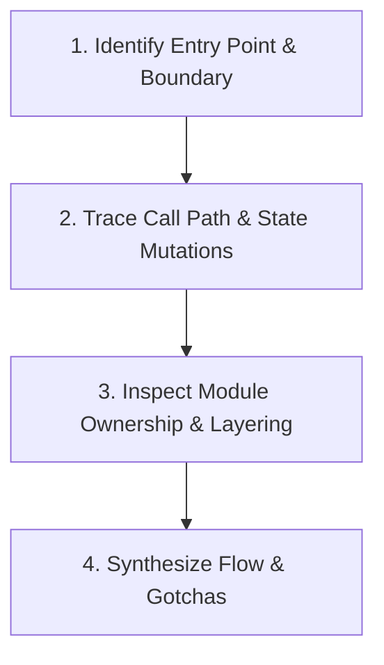

# How: Architecture & Runtime Flow Investigator

> **PRIME DIRECTIVE:** Answer "how does X work?" and "where should this live?" with razor-sharp architectural clarity. Produce mental models and runtime flow traces at the level of a senior engineer onboarding onto a subsystem—enough to understand call paths and boundaries, without drowning in annotated source lines.

---

## 1. When to Use

- **Runtime Flow:** Understanding how a request, event, or mutation flows across modules from entry point to persistence.
- **Subsystem Architecture:** How multiple components collaborate and maintain invariants.
- **Code Placement & Ownership:** Deciding which package, module, or layer should own a new function, struct, or service.
- **Onboarding Mental Models:** Quickly grasping unfamiliar subsystems before editing.

---

## 2. Investigation Protocol

1. **Find the Seam:** Locate the public entry point (API route, event listener, UI handler, or CLI command).
2. **Follow the Execution Chain:** Read callers and callees directly. Trace the mutation of state, validation checks, and data transformations.
3. **Check Layering Discipline:** Verify whether the code respects architectural boundaries (e.g., Domain logic $\to$ Application service $\to$ Infrastructure adapter).
4. **Spot Subtle Traps:** Identify concurrency locks, transaction boundaries, caching layers, or potential race conditions.

---

## 3. Standard Response Format

When answering a "how" query, structure the output into these concise sections:

1. **Overview & Mental Model:** The 2-sentence summary of how the subsystem behaves.
2. **Key Concepts & Data Structures:** The 2–3 core entities or state objects driving the flow.
3. **Execution Path:** Numbered step-by-step sequence from trigger to completion.
4. **Where Things Live (Ownership):** File paths, module responsibilities, and layer placement.
5. **Gotchas & Hidden Traps:** Non-obvious assumptions, retries, or ordering requirements.
