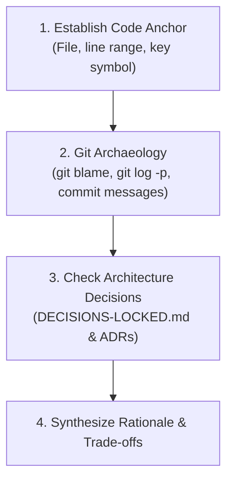

# Why: Design Rationale & History Investigator

> **PRIME DIRECTIVE:** Investigate the historical motivation, forces, constraints, and trade-offs behind code. While `how` explains what code does at runtime, `why` uncovers why it exists in this shape, what broke in the past, and why alternative designs were rejected.

---

## 1. When to Use

- **Design Rationale:** Uncovering why a non-obvious pattern, guard, or constraint was implemented.
- **Architectural Archaeology:** Inspecting git commits, PR discussions, and closed architecture decisions (`docs/DECISIONS-LOCKED.md`).
- **Defensive Logic Origins:** Understanding why complex retries, rate limits, timeouts, or fallback branches were added (often pointing to past outages or platform quirks).
- **Evaluating Refactors:** Checking whether removing "strange-looking" code will re-introduce an old bug.

---

## 2. Investigation Protocol

1. **Establish the Code Anchor:** Identify the exact file path, line range, and symbol in question.
2. **Git Archaeology:**
   - Run `git blame -L <start>,<end> <file>` to find the commit that introduced or modified the logic.
   - Run `git log -1 --stat -p <commit>` to read the author's commit message, reasoning, and context.
3. **Closed Decision Cross-Reference:**
   - Check `docs/DECISIONS-LOCKED.md` to see if the pattern belongs to locked product or architectural rules (A1–G7).
   - Check if an ADR exists in `docs/` explaining the library, pattern, or framework choice.
4. **Epistemic Honesty:**
   - Clearly distinguish between `[VERIFIED]` (explicitly documented in commit messages, PRs, or DECISIONS-LOCKED), `[INFERRED]` (logical deduction from code structure and constraints), and `[ASSUMED]` (speculation).

---

## 3. Standard Response Format

1. **Core Motivation:** The primary problem or constraint that caused this design.
2. **Historical Context & Citations:** Commit hashes, commit messages, PR links, or `DECISIONS-LOCKED.md` entries.
3. **Alternatives Considered & Rejected:** Why simpler or more obvious approaches were discarded.
4. **Current Status & Re-evaluation Risk:** What will break if someone alters or removes this logic today.
